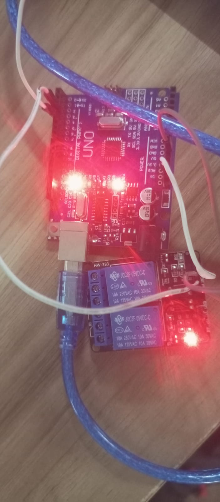

# ⚡ Dual-Channel Relay Control System Using Arduino UNO

### An Embedded Systems Project for Automated Electrical Switching

---

## 1. Project Overview

The **Dual-Channel Relay Control System Using Arduino UNO** is a basic embedded systems project designed to demonstrate automated switching operations using a two-channel relay module.

The system uses an Arduino UNO microcontroller to control two independent relay channels through digital output pins 3 and 4. Both relays are programmed to switch between HIGH and LOW states at fixed time intervals of 2 seconds.

This project demonstrates the practical implementation of digital output control, relay interfacing, timing operations, and basic electrical load automation.

## 2. Project Objectives

- To interface a two-channel relay module with Arduino UNO.
- To understand the working principle of electromagnetic relays.
- To implement automated ON/OFF switching operations.
- To control multiple relay channels using digital output signals.
- To understand the role of relays in electrical load control.
- To develop practical knowledge of embedded system programming.

## 3. Hardware Requirements

| S.No | Component | Quantity | Purpose |
|---|---|---|---|
| 1 | Arduino UNO | 1 | Main microcontroller |
| 2 | 2-Channel Relay Module | 1 | Switching control |
| 3 | Jumper Wires | As required | Electrical connections |
| 4 | USB Cable | 1 | Programming and power supply |

 ## 4. Software Requirements

| Software | Purpose |
|---|---|
| Arduino IDE | Writing and uploading code |
| Embedded C/C++ | Programming language |
| Arduino Serial/USB Interface | Communication with the board |

 ## 5. Circuit Connections

The relay module is connected to the Arduino UNO using the following pin configuration.

| Relay Module Pin | Arduino UNO Pin |
|---|---|
| IN1 | Digital Pin 3 |
| IN2 | Digital Pin 4 |
| VCC | 5V (check module specifications) |
| GND | GND |

### Pin Configuration

- **Relay 1:** Controlled through Digital Pin 3.
- **Relay 2:** Controlled through Digital Pin 4.

Both relay channels operate simultaneously according to the programmed switching sequence.

## ⚙️ 6. Working Principle

The system operates through a continuous switching sequence programmed into the Arduino UNO.

**Step 1 – Initialization**

The Arduino configures digital pins 3 and 4 as output pins using the `pinMode()` function.

**Step 2 – Relay Activation State**

Both relay input pins receive a LOW signal using `digitalWrite()`.

**Step 3 – Time Delay**

The system maintains this output state for 2000 milliseconds (2 seconds).

**Step 4 – Relay Deactivation State**

Both relay input pins receive a HIGH signal.

**Step 5 – Repeated Operation**

The system maintains this state for another 2 seconds and repeats the complete switching sequence continuously.

### Switching Sequence

| Time Interval | Relay 1 (Pin 3) | Relay 2 (Pin 4) |
|---|---|---|
| 0–2 Seconds | LOW | LOW |
| 2–4 Seconds | HIGH | HIGH |
| 4–6 Seconds | LOW | LOW |
| 6–8 Seconds | HIGH | HIGH |

**Note:** The actual ON/OFF operation depends on the relay module's trigger logic. Many commonly available modules are active-LOW.

## 💻 Arduino Code

[View Arduino Code](./two_channel_relay.ino)

## 📷 Project Output

*Figure: Dual-Channel Relay Control System Using Arduino UNO*

##  8. Code Explanation

| Function | Description |
|---|---|
| `pinMode()` | Configures Arduino pins as outputs |
| `digitalWrite()` | Sends HIGH or LOW digital signals |
| `delay(2000)` | Creates a 2-second delay |
| `setup()` | Executes once during initialization |
| `loop()` | Repeats the switching sequence continuously |

##  9. Expected Output

When the program is uploaded successfully:

- Both relay channels change their states simultaneously.
- The switching interval is 2 seconds.
- The relay module indicators respond according to the input signals.
- The switching sequence continues until the Arduino is powered off or reset.

##  10. Real-World Applications

The relay control technique demonstrated in this project can be extended to:

1. **Home Automation:** Automated control of household electrical appliances.
2. **Industrial Automation:** Switching and controlling electrical equipment.
3. **Smart Lighting:** Automated lighting control systems.
4. **Electrical Load Management:** Switching multiple electrical loads.
5. **IoT-Based Automation:** Remote appliance control using Wi-Fi-enabled microcontrollers.
6. **Embedded Control Systems:** Digital switching applications in microcontroller-based projects.

## 11. Learning Outcomes

By developing this project, I gained hands-on experience in:

- Arduino UNO programming and hardware interfacing.
- Digital input/output configuration.
- Relay module interfacing and switching logic.
- Understanding HIGH and LOW digital signals.
- Implementing time-based control operations.
- Developing basic automation systems.

##  12. Future Enhancements

The project can be further improved by incorporating:

- Independent control of each relay channel.
- Push-button-based manual switching.
- Bluetooth-based relay control.
- Wi-Fi-based remote switching using ESP32.
- Sensor-based automatic load control.
- Mobile application integration for smart home automation.

## ⭐ Acknowledgement

This project is part of my continuous learning journey in embedded systems and practical electronics. It helped me understand the fundamentals of microcontroller programming and relay-based switching applications.

**If you find this project useful, consider giving this repository a ⭐ on GitHub!**

---
